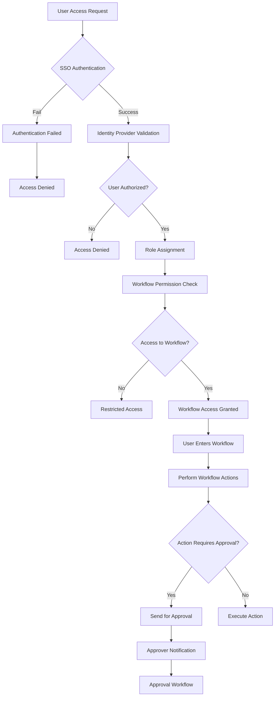
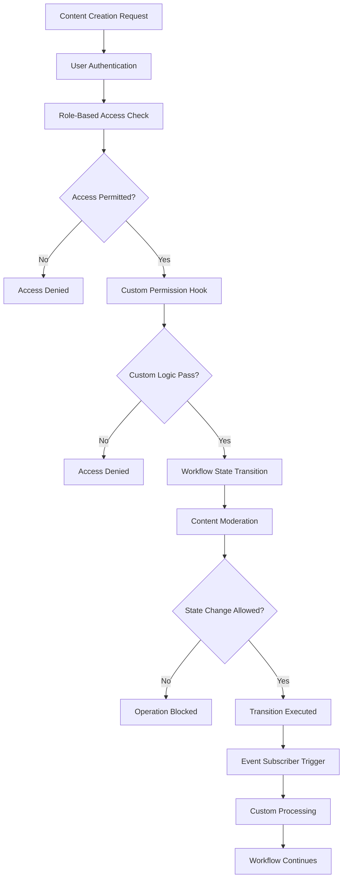
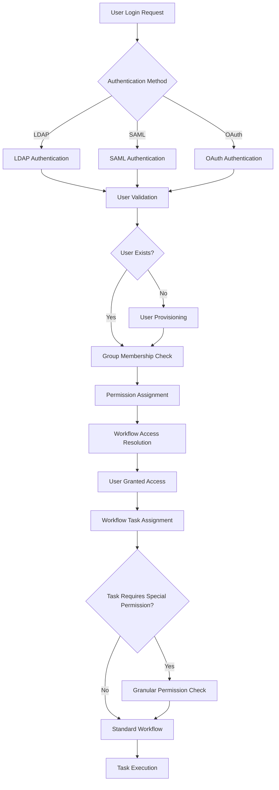
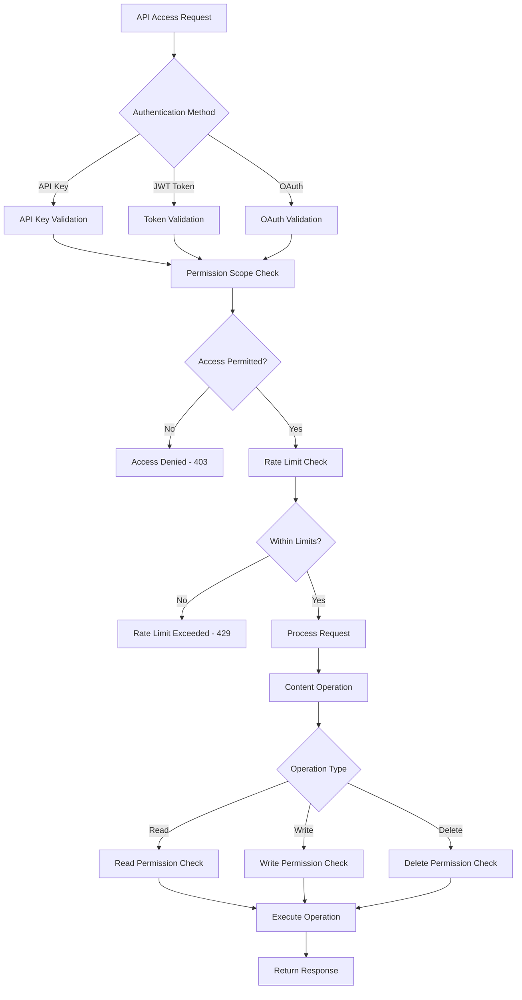

# CMS Identity Management and Authorization Analysis

## Executive Summary

Identity management and authorization are critical components of enterprise Content Management Systems, ensuring secure access control, compliance with regulatory requirements, and proper governance of content publishing workflows. This document provides a comprehensive analysis of identity management capabilities across major CMS platforms, examining how each handles authentication, authorization, enterprise identity integration, and the impact on publishing workflows.

## Analysis Framework

This analysis follows a structured framework for evaluating identity management capabilities in CMS platforms:

1. **Core Identity Functions**: Supported identity protocols and authentication mechanisms
2. **Integration Capabilities**: Compatibility with enterprise identity systems like OpenAM
3. **Authorization Customization**: Flexibility in defining roles, permissions, and custom policies
4. **Audit and Compliance**: Logging capabilities and regulatory compliance features
5. **Workflow Impact**: How identity management affects content publishing workflows
6. **Deployment Model Adaptation**: Identity management across SaaS, self-hosted, and Git-based deployments
7. **Visualization**: Authentication and authorization flow diagrams

## CMS Platform Analysis

### 1. WordPress Identity Management

#### Core Identity Features
- **Authentication Methods**: Username/password with cookie-based sessions
- **User Roles**: Five default roles (Administrator, Editor, Author, Contributor, Subscriber)
- **Permission System**: Capability-based permissions with role hierarchies
- **Session Management**: Cookie-based session handling

#### Enterprise Identity Integration
- **LDAP Integration**: Requires plugins like "LDAP Integration"
- **Active Directory**: Supported through plugins such as "Active Directory Integration"
- **SAML/OAuth**: Available via plugins like "MiniOrange SAML", "OAuth2 Server"
- **OpenID Connect**: Plugin-based support
- **OpenAM Integration**: Requires custom development or third-party plugins

#### Authorization Customization
- **Role Management**: Custom roles can be created through plugins or code
- **Content-Level Permissions**: Limited native support; extended via plugins
- **Custom Policies**: Requires custom code development
- **API Access Control**: Limited to plugin-based implementations

#### Audit and Compliance
- **Audit Trail**: Basic user activity logging; enhanced through plugins
- **Compliance**: GDPR compliance features available via plugins
- **Two-Factor Authentication**: Supported through plugins
- **Password Policies**: Enforced through plugins

#### Workflow Impact
- **Role-Based Workflow**: Limited native support; requires workflow plugins
- **Approval Processes**: Dependent on plugins for multi-step approvals
- **Content Access Control**: Basic permissions affect workflow participation

#### Deployment Model Adaptation
- **Self-Hosted**: Full control over identity implementation
- **Managed WordPress**: Limited identity customization
- **SaaS Limitations**: Not applicable as WordPress is primarily self-hosted

### 2. Drupal Identity Management

#### Core Identity Features
- **Authentication Methods**: Multiple authentication providers
- **User Roles**: Unlimited custom roles with granular capabilities
- **Permission System**: Fine-grained permission system at entity level
- **Session Management**: Robust session handling

#### Enterprise Identity Integration
- **LDAP Integration**: Core LDAP module for authentication and synchronization
- **Active Directory**: Native support through LDAP module
- **SAML/OAuth**: Modules like "SimpleSAMLphp Authentication" and "OAuth"
- **OpenID Connect**: First-class support through dedicated module
- **OpenAM Integration**: Supported via SAML or custom module development

#### Authorization Customization
- **Role Management**: Highly customizable role system
- **Content-Level Permissions**: Advanced access control via modules like "Content Access"
- **Custom Policies**: Hooks and plugins for custom authorization logic
- **API Access Control**: Comprehensive permission system for REST/GraphQL APIs

#### Audit and Compliance
- **Audit Trail**: Comprehensive logging through modules like "Log.module"
- **Compliance**: Strong GDPR and compliance features
- **Two-Factor Authentication**: Supported through modules
- **Password Policies**: Enforced through core and modules

#### Workflow Impact
- **Role-Based Workflow**: Native integration with workflow module
- **Approval Processes**: Granular permissions for workflow states and transitions
- **Content Access Control**: Entity-level permissions affect workflow participation

#### Deployment Model Adaptation
- **Self-Hosted**: Full flexibility for identity implementation
- **Managed Services**: Consistent identity management across environments
- **Cloud Deployments**: Adaptable to cloud identity providers

### 3. Adobe Experience Manager (AEM) Identity Management

#### Core Identity Features
- **Authentication Methods**: Multiple authentication handlers
- **User Roles**: Granular role management with inheritance
- **Permission System**: Access Control List (ACL) system
- **Session Management**: Robust session handling

#### Enterprise Identity Integration
- **LDAP Integration**: Native LDAP support with synchronization
- **Active Directory**: Full integration with attribute mapping
- **SAML/OAuth**: Native SAML 2.0 and OAuth support
- **OpenID Connect**: Supported through extensions
- **OpenAM Integration**: Native integration capabilities

#### Authorization Customization
- **Role Management**: Hierarchical role management
- **Content-Level Permissions**: CUG (Closed User Groups) for content access
- **Custom Policies**: OSGi-based custom authorization implementation
- **API Access Control**: Granite security framework for API permissions

#### Audit and Compliance
- **Audit Trail**: Comprehensive audit logging
- **Compliance**: Strong compliance with enterprise standards
- **Two-Factor Authentication**: Supported through extensions
- **Password Policies**: Enterprise-grade password policies

#### Workflow Impact
- **Role-Based Workflow**: Native integration with workflow engine
- **Approval Processes**: Role-based approval steps with inbox notifications
- **Content Access Control**: Granular permissions affect workflow participation

#### Deployment Model Adaptation
- **On-Premise**: Full enterprise identity integration
- **Cloud Service**: Managed identity with enterprise integration
- **Hybrid Deployments**: Consistent identity management across environments

### 4. Sitecore Identity Management

#### Core Identity Features
- **Authentication Methods**: Multiple authentication providers
- **User Roles**: Role-based security model
- **Permission System**: Granular item-level permissions
- **Session Management**: ASP.NET-based session handling

#### Enterprise Identity Integration
- **LDAP Integration**: Supported through custom development
- **Active Directory**: Native integration
- **SAML/OAuth**: Native SAML support and OAuth integration
- **OpenID Connect**: Supported through Sitecore Identity
- **OpenAM Integration**: Possible via SAML or custom integration

#### Authorization Customization
- **Role Management**: Flexible role-based security
- **Content-Level Permissions**: Item-level security model
- **Custom Policies**: Custom security rules through pipelines
- **API Access Control**: Granular API permissions

#### Audit and Compliance
- **Audit Trail**: Comprehensive logging through Experience Platform
- **Compliance**: Strong compliance features
- **Two-Factor Authentication**: Supported
- **Password Policies**: Enterprise-grade password policies

#### Workflow Impact
- **Role-Based Workflow**: Native integration with workflow engine
- **Approval Processes**: Role-based approval steps
- **Content Access Control**: Item-level permissions affect workflow participation

#### Deployment Model Adaptation
- **On-Premise**: Full enterprise identity integration
- **Azure Cloud**: Native Azure AD integration
- **Hybrid Deployments**: Consistent identity management

### 5. Contentful Identity Management

#### Core Identity Features
- **Authentication Methods**: Email/password, API keys
- **User Roles**: Predefined roles with granular permissions
- **Permission System**: Space and content-type level permissions
- **Session Management**: Token-based authentication

#### Enterprise Identity Integration
- **LDAP Integration**: Limited via SAML
- **Active Directory**: Supported through SAML on enterprise plans
- **SAML/OAuth**: SAML-based SSO on enterprise plans
- **OpenID Connect**: Limited support
- **OpenAM Integration**: Possible via SAML

#### Authorization Customization
- **Role Management**: Custom roles on enterprise plans
- **Content-Level Permissions**: Space and content-type level
- **Custom Policies**: Limited customization
- **API Access Control**: Granular API key permissions

#### Audit and Compliance
- **Audit Trail**: Comprehensive activity logging
- **Compliance**: GDPR, SOC 2, ISO 27001 compliant
- **Two-Factor Authentication**: Supported
- **Password Policies**: Standard enterprise policies

#### Workflow Impact
- **Role-Based Workflow**: Native role-based workflow permissions
- **Approval Processes**: Role-based approval steps
- **Content Access Control**: Content-type level permissions affect workflow participation

#### Deployment Model Adaptation
- **SaaS**: Fully managed identity services
- **Hybrid Deployments**: API-based identity integration

### 6. Strapi Identity Management

#### Core Identity Features
- **Authentication Methods**: JWT-based authentication
- **User Roles**: Customizable role system
- **Permission System**: Granular content-type level permissions
- **Session Management**: Token-based authentication

#### Enterprise Identity Integration
- **LDAP Integration**: Plugin-based support
- **Active Directory**: Plugin-based integration
- **SAML/OAuth**: Custom development or plugin support
- **OpenID Connect**: Possible through custom development
- **OpenAM Integration**: Possible via custom development

#### Authorization Customization
- **Role Management**: Highly customizable roles
- **Content-Level Permissions**: Content-type level permissions
- **Custom Policies**: Custom policies through middleware
- **API Access Control**: Granular API endpoint permissions

#### Audit and Compliance
- **Audit Trail**: Custom implementation required
- **Compliance**: Depends on implementation
- **Two-Factor Authentication**: Possible through custom development
- **Password Policies**: Configurable through settings

#### Workflow Impact
- **Role-Based Workflow**: Customizable workflow permissions
- **Approval Processes**: Custom implementation required
- **Content Access Control**: Content-type level permissions affect workflow participation

#### Deployment Model Adaptation
- **Self-Hosted**: Full control over identity implementation
- **Cloud Deployments**: Adaptable to cloud identity providers

### 7. Decap CMS Identity Management

#### Core Identity Features
- **Authentication Methods**: Git provider authentication
- **User Roles**: Limited role system based on Git permissions
- **Permission System**: Repository and branch level
- **Session Management**: Git provider session management

#### Enterprise Identity Integration
- **LDAP Integration**: Not directly supported
- **Active Directory**: Through Git provider integration
- **SAML/OAuth**: Through Git provider SSO
- **OpenID Connect**: Through Git provider
- **OpenAM Integration**: Not directly supported

#### Authorization Customization
- **Role Management**: Limited to Git provider roles
- **Content-Level Permissions**: File-based permissions
- **Custom Policies**: Limited customization
- **API Access Control**: Git API based permissions

#### Audit and Compliance
- **Audit Trail**: Git history provides natural audit trail
- **Compliance**: Depends on Git provider
- **Two-Factor Authentication**: Git provider 2FA
- **Password Policies**: Git provider policies

#### Workflow Impact
- **Role-Based Workflow**: Git provider permissions affect workflow
- **Approval Processes**: Pull request based approvals
- **Content Access Control**: Branch protection affects workflow participation

#### Deployment Model Adaptation
- **Git-Based**: Native integration with Git provider identity
- **Static Site Deployments**: Minimal identity requirements

## Identity Management Comparison

### Core Identity Features Comparison

| Feature | WordPress | Drupal | AEM | Sitecore | Contentful | Strapi | Decap CMS |
|---------|-----------|--------|-----|----------|------------|--------|-----------|
| LDAP Integration | Plugin | Core | Native | Native | Limited | Plugin | N/A |
| Active Directory | Plugin | Plugin | Native | Native | SAML | Plugin | Git Provider |
| SAML Support | Plugin | Module | Native | Native | Enterprise | Custom | Git Provider |
| OAuth Support | Plugin | Module | Native | Native | Limited | Custom | Git Provider |
| OpenID Connect | Plugin | Native | Native | Native | Limited | Custom | Git Provider |
| Custom Authentication | Custom | Native | Native | Native | Limited | Native | Git Provider |
| JWT Support | Plugin | Plugin | Native | Native | Native | Native | N/A |

### Authorization Customization Comparison

| Feature | WordPress | Drupal | AEM | Sitecore | Contentful | Strapi | Decap CMS |
|---------|-----------|--------|-----|----------|------------|--------|-----------|
| Custom Roles | Custom | Native | Native | Native | Enterprise | Native | Limited |
| Granular Permissions | Plugin | Native | Native | Native | Native | Native | Git Provider |
| Content-Level Permissions | Plugin | Native | Native | Native | Native | Native | Git Provider |
| API Permissions | Custom | Native | Native | Native | Native | Native | N/A |
| Custom Policies | Custom | Native | Native | Native | Limited | Native | Limited |
| Workflow Permissions | Plugin | Native | Native | Native | Native | Native | Git Provider |

### Audit and Compliance Comparison

| Feature | WordPress | Drupal | AEM | Sitecore | Contentful | Strapi | Decap CMS |
|---------|-----------|--------|-----|----------|------------|--------|-----------|
| Audit Trail | Plugin | Native | Native | Native | Native | Custom | Git History |
| Two-Factor Auth | Plugin | Native | Native | Native | Native | Custom | Git Provider |
| Compliance Certifications | Plugin | Native | Native | Native | Certified | Certified | Git Provider |
| Password Policies | Plugin | Native | Native | Native | Native | Configurable | Git Provider |
| Access Logs | Plugin | Native | Native | Native | Native | Custom | Git History |

## Identity Management Workflows

### Enterprise SSO Workflow

### Drupal Custom Authorization Workflow

### AEM Identity Integration Workflow

### Headless CMS API Authorization Workflow

## Deployment Model Impact on Identity Management

### Self-Hosted Solutions
- **WordPress, Drupal, Strapi**: Full control over identity implementation
- **Pros**: Complete customization, direct integration with enterprise systems
- **Cons**: Infrastructure management required, security responsibility
- **Best For**: Organizations with dedicated security teams and specific compliance requirements

### Managed Services
- **AEM, Sitecore**: Vendor-managed identity with enterprise integration
- **Pros**: Enterprise-grade security, seamless integration with identity providers
- **Cons**: Limited customization, vendor dependency
- **Best For**: Large enterprises seeking comprehensive identity management with vendor support

### SaaS Solutions
- **Contentful**: Fully managed identity services
- **Pros**: No infrastructure management, automatic updates
- **Cons**: Limited customization, dependency on vendor
- **Best For**: Organizations wanting to focus on content rather than identity management

### Git-Based Solutions
- **Decap CMS**: Leveraging Git provider identity
- **Pros**: Simple implementation, natural audit trail
- **Cons**: Limited to Git provider capabilities
- **Best For**: Development teams already using Git workflows

## Identity Management Recommendations

### For Enterprise Organizations
1. **AEM or Sitecore** for comprehensive enterprise identity management
2. Implement native SSO for seamless user experience
3. Utilize granular permissions for fine-grained access control
4. Leverage built-in audit trails for compliance requirements

### For Open Source Projects
1. **Drupal** for the most robust open-source identity management
2. Use core and contributed modules for enterprise identity integration
3. Implement custom hooks for specific authorization needs
4. Utilize existing audit modules for compliance

### For API-First Implementations
1. **Contentful** for managed identity with good workflow integration
2. **Strapi** for customizable identity with full control
3. Implement custom authentication and authorization as needed
4. Use webhooks for workflow notifications and audit trails

### For Static Site Workflows
1. **Decap CMS** with Git provider identity management
2. Leverage existing Git provider SSO and permissions
3. Use pull request workflows for content approval
4. Utilize Git history for audit trails

## Implementation Best Practices

### Identity Integration Planning
1. **Assess Existing Infrastructure**: Evaluate current identity systems before selection
2. **Define Requirements**: Document specific identity and authorization needs
3. **Plan for Growth**: Consider future scalability requirements
4. **Compliance First**: Ensure alignment with regulatory requirements

### Custom Authorization Development
1. **Modular Design**: Build authorization as reusable components
2. **Test Thoroughly**: Implement comprehensive testing for authorization logic
3. **Document Clearly**: Maintain clear documentation of custom policies
4. **Monitor Performance**: Track authorization performance impacts

### Audit and Compliance
1. **Comprehensive Logging**: Ensure all access and changes are logged
2. **Regular Audits**: Schedule periodic access reviews
3. **Compliance Documentation**: Maintain documentation for compliance audits
4. **Alerting System**: Implement alerts for suspicious activities

## Conclusion

Identity management is a critical consideration for any enterprise CMS implementation. The choice of CMS significantly impacts how identity and authorization can be implemented, with implications for security, compliance, and workflow efficiency.

1. **Enterprise CMS platforms** (AEM, Sitecore) provide the most comprehensive identity management features with native enterprise integration
2. **Drupal** offers the most robust open-source identity management capabilities
3. **Headless CMS platforms** (Contentful, Strapi) provide varying levels of identity management with different customization approaches
4. **Git-based systems** (Decap CMS) leverage existing Git provider identity systems

Organizations should evaluate their identity management requirements alongside workflow needs, considering their existing infrastructure, compliance requirements, and technical capabilities. A well-designed identity management strategy is essential for secure, compliant, and efficient content management operations.