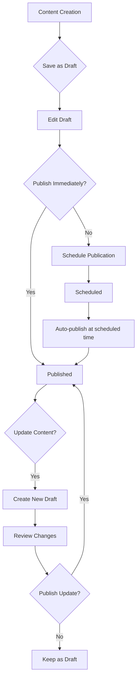
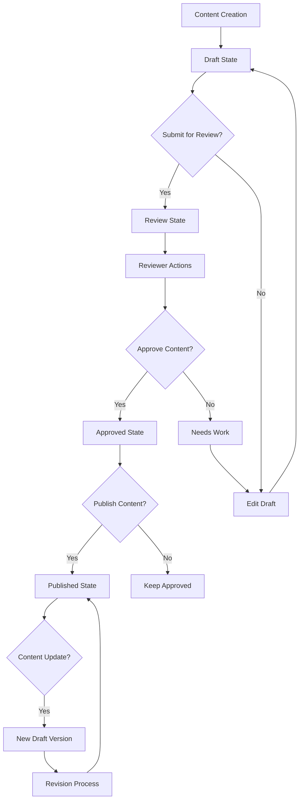
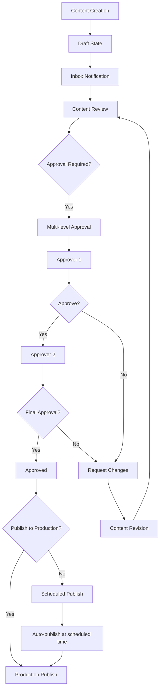
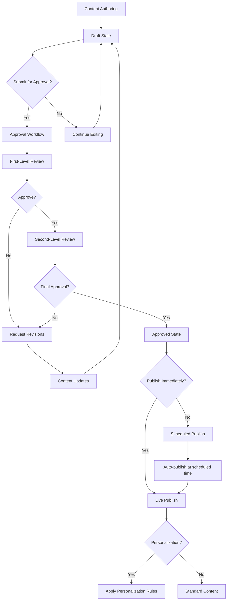
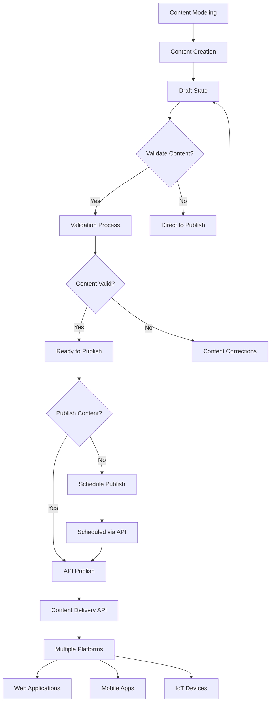
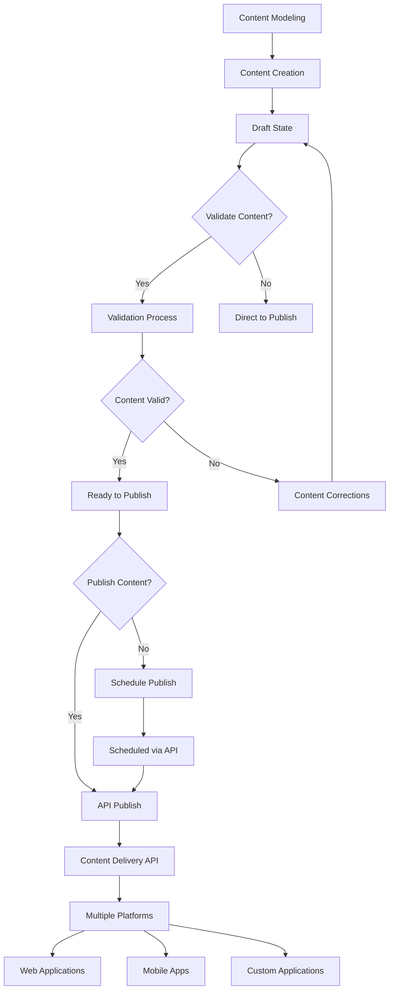
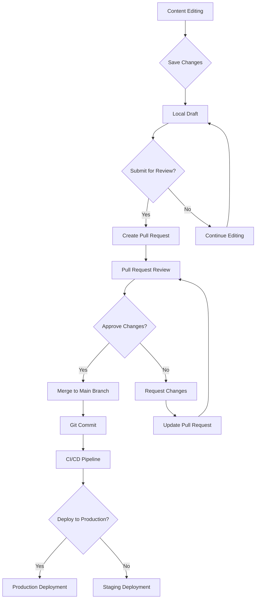
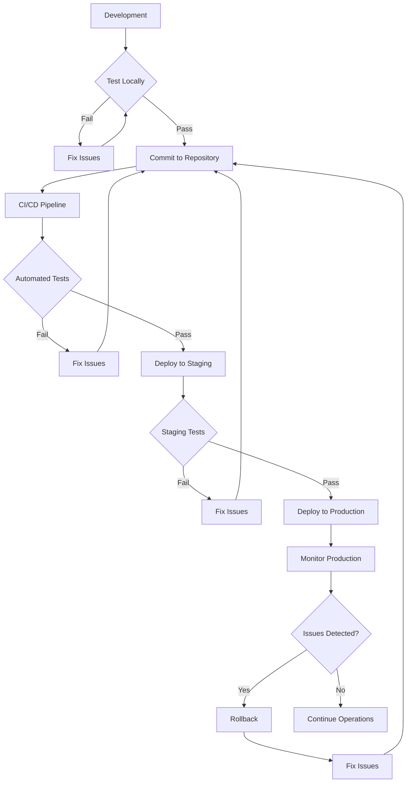
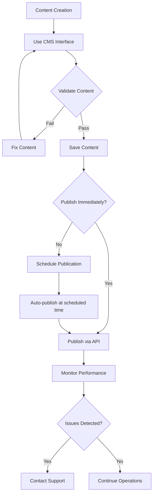
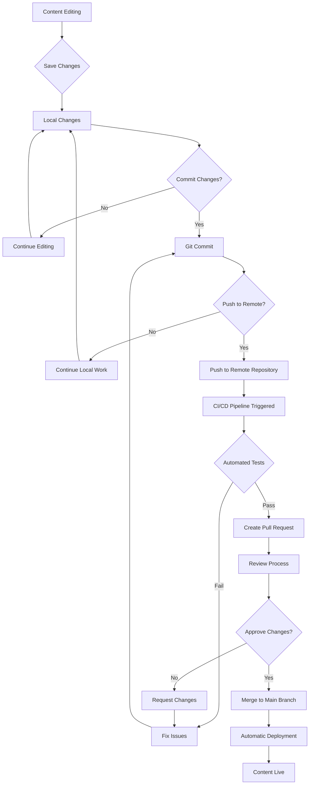

# CMS Publishing Workflows - Mermaid Diagrams

## 1. WordPress Publishing Workflow

## 2. Drupal Publishing Workflow

## 3. Adobe Experience Manager (AEM) Publishing Workflow

## 4. Sitecore Publishing Workflow

## 5. Contentful Publishing Workflow

## 6. Strapi Publishing Workflow

## 7. Decap CMS Publishing Workflow

## 8. Deployment Model Workflows

### Self-Hosted Deployment Workflow

### SaaS Deployment Workflow

### Git-Based Deployment Workflow

## Workflow Comparison Summary

Each CMS platform has a distinct approach to content publishing workflows:

1. **WordPress**: Simple linear workflow, best extended with plugins for enterprise use
2. **Drupal**: State-based workflow with customizable transitions and robust permissions
3. **AEM**: Visual workflow designer with multi-level approvals and creative integration
4. **Sitecore**: Marketing-focused workflow with personalization integration
5. **Contentful**: API-first approach with external workflow tool integration
6. **Strapi**: API-first approach similar to Contentful with customization through code
7. **Decap CMS**: Git-based workflow with pull request review process

Additionally, deployment models significantly impact how content moves through systems:

1. **Self-Hosted**: Requires comprehensive deployment and testing workflows
2. **SaaS**: Simplified workflow with vendor-managed infrastructure
3. **Git-Based**: Integrated content and deployment workflow through version control

These diagrams illustrate the core workflow patterns of each platform, showing how content moves from creation to publication, including review and approval processes where applicable. The deployment model workflows show how infrastructure considerations affect content publishing processes.